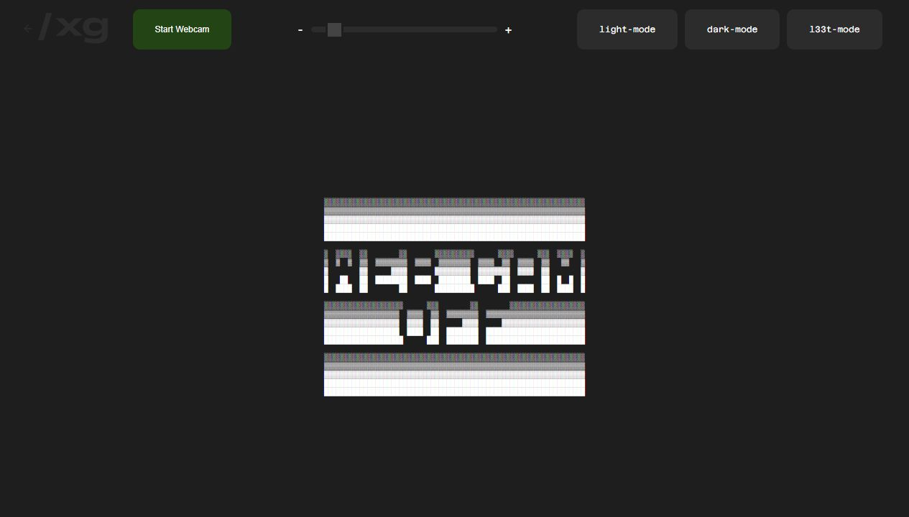

# cam2ascii

> A browser experiment that turns a live webcam feed into ASCII art.

## Try it

Select **Start Webcam** and allow camera access in your browser. Use the slider to change the ASCII detail and switch among light, dark, and l33t modes.
